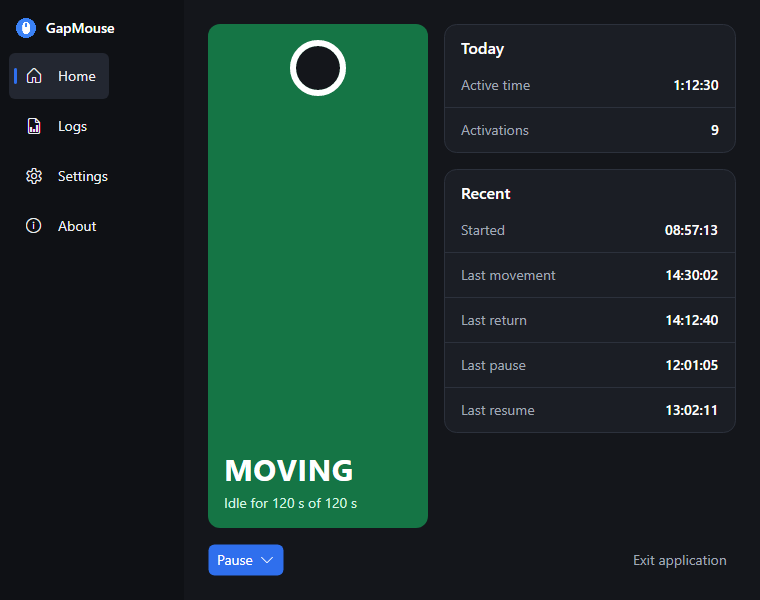
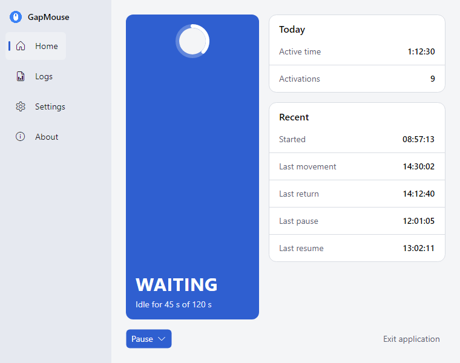
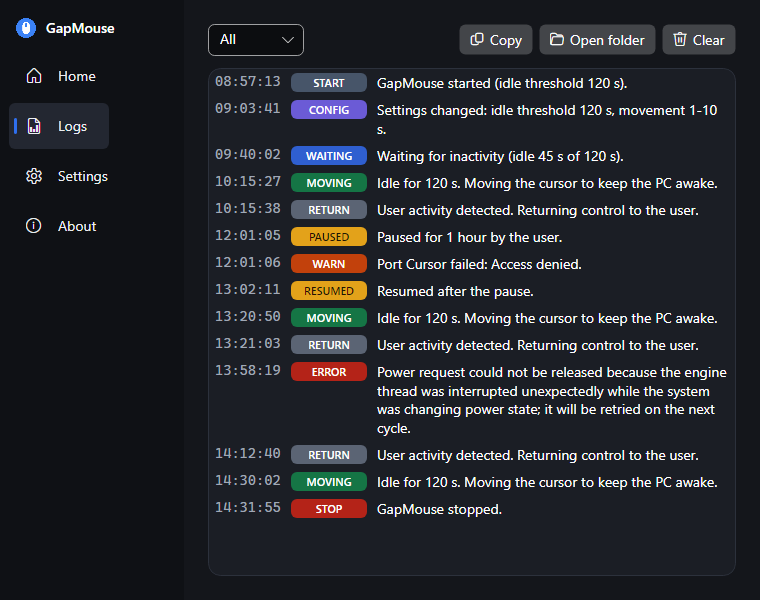
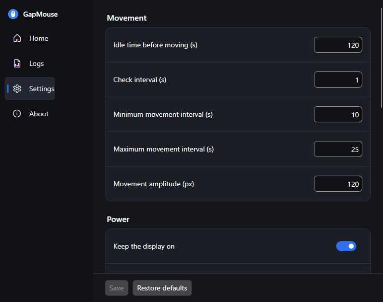

# GapMouse

[](https://github.com/Gustavo-Piccoli/GapMouse/actions/workflows/ci.yml)
[](https://github.com/Gustavo-Piccoli/GapMouse/actions/workflows/codeql.yml)
[](https://github.com/Gustavo-Piccoli/GapMouse/releases/latest)
[](LICENSE)

Keeps your Windows PC awake and your status available while you're away — light, private, no admin required.

Releases are published on [GitHub Releases](https://github.com/Gustavo-Piccoli/GapMouse/releases). See the [roadmap](#roadmap).

## Screenshots






The images are generated by `tools/GapMouse.Screenshots`.

## Download

Get the latest build from [GitHub Releases](https://github.com/Gustavo-Piccoli/GapMouse/releases/latest):

- **Installer** (`GapMouse-Setup-<version>-<arch>.exe`): installs per user, no admin rights needed. It always adds a Start Menu shortcut, and offers a desktop shortcut (checked by default) and a "Start with Windows" checkbox (unchecked by default).
- **Portable zip** (`GapMouse-<version>-<arch>-portable.zip`): unzip anywhere and run `GapMouse.exe`. Settings and logs stay next to the exe, so it runs from a USB drive.
- **winget**: `winget install GustavoPiccoli.GapMouse` (available after the first winget submission is approved).
- **`SHA256SUMS.txt`**: checksums for every file in the release.

Pick **x64** for most PCs (Intel and AMD) and **ARM64** for Windows on ARM devices (for example Snapdragon laptops).

The builds are not code-signed yet, so Windows SmartScreen may warn you. Choose "More info" and then "Run anyway". Code signing through SignPath is planned.

To uninstall, use "Installed apps" in Windows Settings. Your settings in `%AppData%\GapMouse` and logs in `%LocalAppData%\GapMouse\logs` are kept.

If a settings file already exists, the app's saved "Start with Windows" choice wins over the installer checkbox the next time the app starts.

## Build from source

Prerequisite: the [.NET SDK](https://dotnet.microsoft.com/download) 10.0.300 or newer (pinned in `global.json`), on Windows.

```powershell
dotnet build
dotnet test
```

`dotnet test` runs everything, including the tests that call the real Win32 APIs. These move the cursor by 1 px, so keep your hands off the mouse for a couple of seconds. To skip them (as CI does):

```powershell
dotnet test --filter-not-trait "Category=Win32"
```

Tests run on Microsoft.Testing.Platform, hence the `--filter-not-trait` syntax.

### Developer console

A small Native AOT console app that drives the engine and prints its events. It is a developer tool and is not shipped.

```powershell
dotnet run --project tools/GapMouse.DevConsole -- --idle 10 --min 3 --max 5
dotnet publish tools/GapMouse.DevConsole -c Release -r win-x64 -o artifacts/devconsole
```

Flags: `--idle <s>`, `--check <s>`, `--min <s>`, `--max <s>`, `--amplitude <px>`, `--display on|off`. Keys: `p` pause, `t` pause for 1 minute, `r` resume, `q` quit (Ctrl+C also exits cleanly).

## Using GapMouse

Start GapMouse from the Start Menu (installed) or run `GapMouse.exe` (portable). Developers can use `dotnet run --project src/GapMouse.App`. The app lives in the notification area (tray).

- **Tray icon color:** blue while waiting, green while moving the mouse, amber while paused. The tooltip shows the state.
- **Tray menu (right click):** `Pause` (10 min, 30 min, 1 h, Custom, Never) or `Resume` when paused, then `Open` and `Exit`. Double-click opens the window.
- **Hotkey:** `Ctrl+Alt+P` toggles between pause (never) and resume. You can change it in Settings.
- **Close to tray:** the window's close button hides it; the app keeps running. The first time, a balloon tells you so. Quit with `Exit` in the tray menu or `Exit application` on the Home tab.
- **Start minimized:** start with `--minimized`, or turn on "Start minimized" in Settings, to show only the tray icon. "Start with Windows" registers the app with `--minimized`.
- **Locked screen:** the mouse stops moving while the session is locked (Win+L, auto lock). By default Windows then follows its normal power plan; turn on "Keep the PC awake while the screen is locked" in Settings to keep the system (not the display) awake.
- **Single instance:** launching a second copy brings the running window to the front and exits.
- **Tabs:** Home (state, today's stats, pause and resume), Logs (live activity log with filter, copy and open folder), Settings (engine, startup, theme, language, hotkey, logs) and About (version, update check, paths).

Theme (dark or light) and language (English or Portuguese, or follow Windows) change immediately, with no restart.

## Architecture

Clean Architecture with a functional core:

- `GapMouse.Domain` — pure logic: the `KeepAwakeEngine` state machine, movement planning, settings validation. No I/O.
- `GapMouse.Application` — ports and `EngineHost`, which runs the engine on a dedicated thread. Engine ports: cursor, idle time, monitor bounds, power requests. Persistence and system ports: settings store, app state store, activity log, startup registrar (start with Windows), release source (update check).
- `GapMouse.Infrastructure` — Win32 adapters for the engine ports, plus file, registry and GitHub implementations of the persistence and system ports.
- `GapMouse.Infrastructure/Shell` — the Windows shell integration: a hidden shell window, the tray icon with balloons, the global hotkey and the single-instance guard (see ADR 0006).
- `GapMouse.App` — the Avalonia desktop app: views, view models (no Avalonia references), localization, UI services and the composition root. It runs on Avalonia's UI thread and is published with Native AOT.

Design decisions are recorded as ADRs in [`docs/adr/`](docs/adr/). The original PowerShell script lives in [`legacy/`](legacy/).

## Your data

GapMouse stores everything locally and needs no admin rights.

| Mode | Settings and state | Logs |
|---|---|---|
| Installed | `%AppData%\GapMouse` | `%LocalAppData%\GapMouse\logs` |
| Portable | next to the exe | `logs\` next to the exe |

Portable mode is on when a file named `portable` (no extension) or `GapMouse.settings.json` exists next to the exe.

- `GapMouse.settings.json`: your settings.
- `GapMouse.state.json`: today's counters (moving time and activations).
- `gapmouse-yyyy-MM-dd.log`: one activity log per day, kept for 7 days by default (configurable, 1 to 365). With N days, a file is deleted when the date in its name is earlier than today minus N, so N = 7 keeps today plus the 7 previous days.

The only network call is the optional update check: a `GET` to `https://api.github.com/repos/Gustavo-Piccoli/GapMouse/releases/latest` at start and then every 24 hours. It never downloads or installs anything. Turn it off by setting `"checkForUpdates": false` in the `system` section of the settings file (or untick it in the Settings tab).

The developer console always keeps its data next to its own exe.

## Roadmap

1. Foundation and headless engine.
2. Persistence and system integration.
3. Avalonia desktop app: tray, tabs, themes, i18n.
4. Distribution: installer, portable build, release pipeline (current).
5. Post-v1: winget submission, code signing.

## Disclaimer

Using this tool on a corporate machine is your own responsibility. Check your company's policies before running it.

## Privacy

No telemetry. The only network call is an optional update check.

## License

[MIT](LICENSE)
